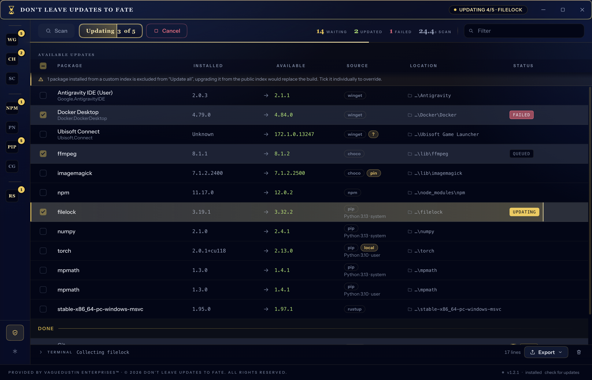
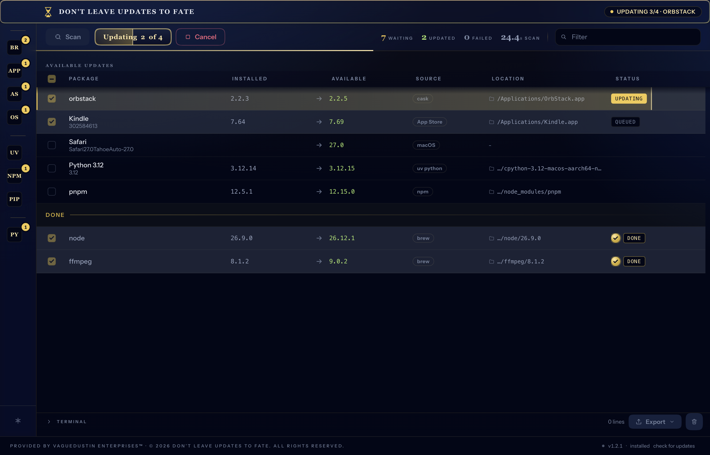
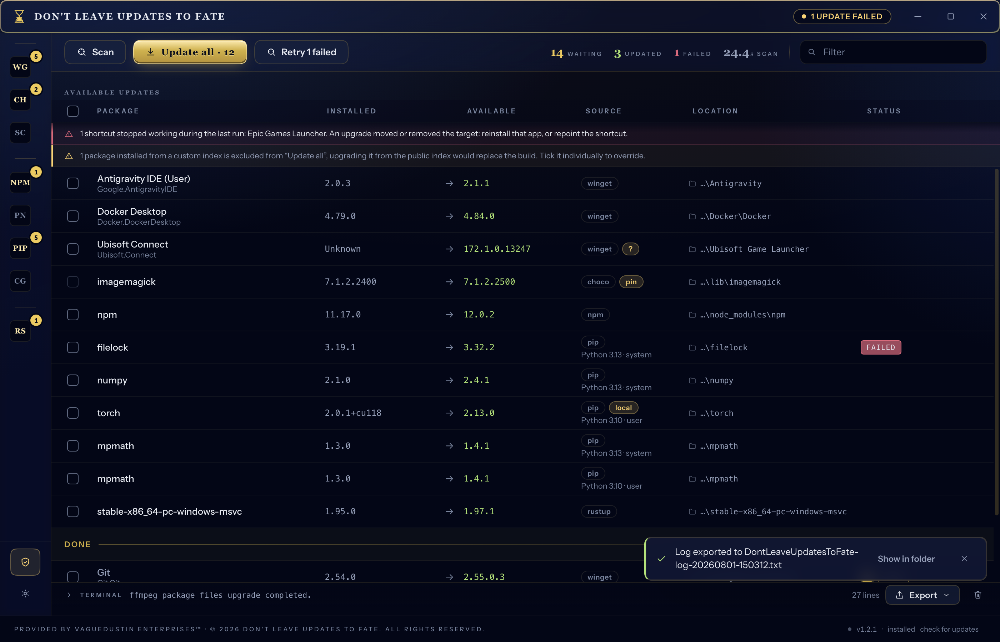
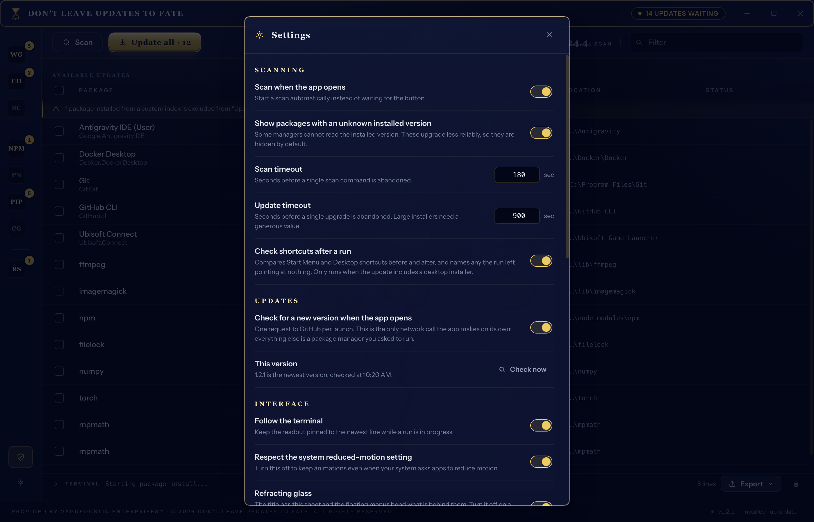
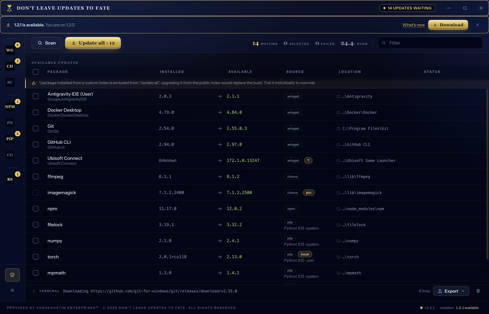

<div align="center">

<h1></h1>

**Every manager on this machine, read in one pass.**

A desktop app for Windows and macOS that asks every package manager on your system what has fallen
behind, then updates them one at a time with a live terminal readout you can export.

Provided by VagueDustin Enterprises™.

**[Download the latest release](https://github.com/VagueDustin/DontLeaveUpdatesToFate/releases/latest)**

</div>



---

## What it does

Press one button and it asks every package manager on the machine what is out of date:

| Platform | Managers |
| --- | --- |
| **Windows** | winget, Chocolatey, Scoop |
| **macOS** | Homebrew (tools and apps), the Mac App Store, macOS updates, uv (tools and Pythons) |
| **Both** | npm, pnpm, pip, cargo, rustup |

It shows the lot in one table (installed version, available version, which manager it came from, where
it lives on disk) and updates what you select, one package at a time, streaming every line of output
as it happens.

- **One pass over everything.** Managers are scanned concurrently. Placeholder rows hold the table's
  shape while they report, and each manager's rows ease in as it answers.
- **The Ledger.** Nothing leaves the table during a run. The package being updated fills with gold; each
  one that finishes gets a gold seal and files under **Done**, so the whole run stays on screen to
  review. A failure stays above the line, next to **Retry**.
- **Buttons that show their progress.** "Update all" becomes a progress bar with a running count while
  it works, with Cancel beside it. Scan shows how many managers have reported.
- **Updates run one at a time.** Two installers writing to the same tree is how an install gets
  corrupted, and a single stream is the only way the terminal stays readable.
- **pip, per interpreter.** A machine usually has several Pythons. All of them are found and scanned
  separately, so nothing hides behind whichever `pip` happens to be first on `PATH`.
- **Where it is, on disk.** Every row carries the install location. Select it to show the folder in
  Explorer or Finder, or copy the full path from the row menu.
- **A real terminal readout.** Every command is echoed before it runs, so an exported log reads as a
  transcript you could replay by hand.
- **Export the log** as plain text, Markdown or JSON, with a header recording the app version, the OS,
  administrator rights or prompts, and the version of every manager involved, then a package inventory:
  what was found, what happened to it, and where it lives.
- **Honest about administrator rights.** On Windows, winget and Chocolatey install machine-wide, so the
  app offers one button to restart elevated. On a Mac, the few updates that need it ask for your
  password in the standard macOS dialog, one at a time.
- **Cancel means cancel.** Cancelling stops the whole process tree, including an installer's own
  helpers.
- **It updates itself,** from this repository's releases, after checking the download against the
  published checksum.

---

## Screenshots

<table>
<tr>
<td width="50%">

**On a Mac.** Homebrew tools and apps, the App Store, macOS updates and uv beside npm and pip, with
locations you can open in Finder. The window keeps the native red, yellow and green buttons.

</td>
<td width="50%">

[](docs/screenshots/preview-macos.png)

</td>
</tr>
<tr>
<td width="50%">

**A run that finished with something to say.** Packages updated and filed under Done, one failed on
permissions and is offered a retry, one custom-index build held back from "Update all", and a
shortcut that stopped resolving during the run: the check that exists because an upgrade can return
exit code 0 and still leave an app unable to start.

</td>
<td width="50%">

[](docs/screenshots/preview-finished.png)

</td>
</tr>
<tr>
<td width="50%">

**Settings.** Scan behaviour, timeouts, the after-run app check, the update check, and the list of
packages you have told it to stop offering, either for one version or for good.

</td>
<td width="50%">

[](docs/screenshots/preview-settings.png)

</td>
</tr>
<tr>
<td width="50%">

**It updates itself.** A strip under the title bar when there is a newer release, with a link to the
notes and nothing fetched until you press Download. See [Updating itself](#updating-itself).

</td>
<td width="50%">

[](docs/screenshots/preview-update.png)

</td>
</tr>
</table>

> These come from the design harness (`node scripts/preview-server.mjs`), which mounts the real
> interface against invented data. That is deliberate: a screenshot of a real machine is a screenshot
> of somebody's installed software and file paths.

---

## Install

**[Download the latest release](https://github.com/VagueDustin/DontLeaveUpdatesToFate/releases/latest)** ·
[Release history](#release-history)

### macOS

One build for Apple Silicon Macs:

| Artifact | What it is |
| --- | --- |
| `DontLeaveUpdatesToFate-<version>-arm64.dmg` | Open it and drag the app to Applications. |

The app is **not notarized**, because notarization needs a paid Apple Developer account, so macOS
blocks it the first time:

1. Open the app from Applications. macOS says it could not verify the app. Choose **Done**, not Move to
   Trash.
2. Open **System Settings › Privacy & Security** and scroll to **Security**. It says the app was
   blocked, with an **Open Anyway** button. The button appears for about an hour after the blocked
   launch.
3. Choose **Open Anyway**, confirm with your password or Touch ID, then choose **Open**.

After that it opens normally, including after it updates itself. (Right-click › Open no longer
bypasses this on macOS 15 and later.)

Keep the app in **Applications**. It updates itself by replacing its own bundle, which it cannot do
while running from the mounted disk image; a copy run from there offers the Releases page instead.

**On a Mac it covers:**

- **Homebrew**, as two rows: command-line tools (formulae) and apps (casks). Apps that keep themselves
  current, like Chrome or Discord, are hidden by default, as `brew` hides them; Settings can include
  them. Updating an app closes it first, and the log names any open ones before the run starts.
- **The Mac App Store**, through the free `mas` tool. If it is missing, select the App Store tile and
  the app installs it with Homebrew. `mas` can only update apps for the Apple Account signed in to the
  App Store, and recent versions need your password for each update.
- **macOS updates** from `softwareupdate`, including Safari and security responses. Updates that need a
  restart are labelled and run last, and the app never restarts the Mac itself. A new major version of
  macOS is listed but never included in "Update all".
- **uv**: tools from `uv tool install`, and the Pythons uv manages, which move to the newest patch.
- **npm, pnpm, pip, cargo and rustup**, as on Windows. pip finds every Python on `PATH`, in Homebrew and
  in uv. Packages in a Python another tool owns (Homebrew's, uv's, or Apple's own) are listed but
  never upgraded through pip; that tool should do it.

Opened from the Dock, a Mac app does not get your Terminal's `PATH`, so it would find none of these. At
startup the app asks your login shell for its `PATH` and the managers' settings once, with a hard
3.5 second limit, and falls back to the usual Homebrew and user locations if that fails.

### Windows

Two builds, both x64, both Windows 10 1809 or newer:

| Artifact | What it is |
| --- | --- |
| `DontLeaveUpdatesToFate-<version>-portable.exe` | Single file. Run it from anywhere, installs nothing. |
| `DontLeaveUpdatesToFate-<version>-setup.exe` | Normal installer: pick a directory, get a Start Menu entry and an Add/Remove entry. |

Each release also carries an `.appx` (the Microsoft Store package) and a `SHA256SUMS` file for the
updater.

Both exes are **unsigned**. Without a code-signing certificate, SmartScreen shows "Windows protected
your PC" on first run; choose *More info*, then *Run anyway*. Signing is the only real fix, and nothing
in the app can suppress that warning.

The installer installs to `C:\Program Files\VagueDustin Enterprises\Don't Leave Updates To Fate`, the
publisher folder, alongside the other products already there; the directory page still lets you change
it.

### Administrator rights

**On a Mac there is no restart.** The few commands that need root (installing a macOS update, updating
an App Store app with current `mas`, and the occasional Homebrew app whose installer asks) run through
`sudo`, which shows the standard macOS password dialog through a small helper shipped with the app. The
password goes from that dialog to `sudo` and nowhere else; the app never sees, stores or logs it. The
exported log counts how many prompts were shown and how many were declined.

**On Windows** the app deliberately starts **unelevated**, so scanning your npm globals doesn't need a
UAC prompt. When a run needs administrator rights, use **Restart as admin** in the sidebar.
Machine-wide managers (winget, Chocolatey, and any system-wide Python) fail without it, and the app says
so in the failure detail rather than making you read the transcript.

The relaunch closes the window, then opens the elevated copy. That ordering is deliberate: a helper
waits for the original process to exit before starting the elevated one, so the two never coexist and
the new instance cannot lose the single-instance lock. Whether you see a UAC prompt depends on your own
policy; with `ConsentPromptBehaviorAdmin = 0` Windows elevates silently. Each launch appends a few
lines, including `elevated=true|false`, to `%APPDATA%\dont-leave-updates-to-fate\startup.log`, because
a process that exits during startup otherwise leaves no evidence at all.

### Updating itself

On launch the app asks `api.github.com` for this project's latest release and compares the tag with the
running version. If there is something newer, a strip appears under the title bar: what version, what
you are on, a link to the notes, and a Download button. Nothing is fetched until you press it.

The download goes to your **Downloads** folder and is hashed as it arrives, then checked against the
`SHA256SUMS` file published with the release. A mismatch deletes the file. **Be clear about what that
proves**: the checksums come from the same release as the binary, so they catch a truncated or
corrupted download and nothing more. Whether the release itself is honest is what code signing answers,
and these builds are not signed.

Each kind of install gets the right artifact and the right way of installing it:

| Build | What "install" does |
| --- | --- |
| macOS | Closes the app; a helper mounts the downloaded disk image, swaps the new app into place, clears the quarantine flag and opens it. If anything fails, the current version stays and opens instead. |
| Windows installed | Closes the app, then runs the installer's normal wizard. Not `/S`: silently replacing an application is not something software should do to someone, even at their own request. |
| Windows portable | Closes the app, overwrites the exe you started with the new one, and starts it again. |
| Unpackaged (`npm run dev`) | Checks, but is never offered an artifact. |

Every path hands off to a helper that waits for this process to exit before touching anything, because
a running app cannot replace itself safely. Every attempt is recorded in `handover.log` in the app's
data folder (`%APPDATA%\dont-leave-updates-to-fate\updates` on Windows,
`~/Library/Application Support/dont-leave-updates-to-fate/updates` on a Mac).

**The check is the only network request this app makes on its own.** Everything else is a package
manager you asked to run. It is one call per launch, and Settings turns it off (the manual *Check now*
button still works).

---

## Locations

Every row shows where the package actually lives. Selecting the path shows it in Explorer or Finder,
and the row menu (⋯) offers *Show in Explorer* or *Show in Finder* and **Copy path** alongside the skip
actions. The location is searchable, so `site-packages` or `Program Files` narrows the table, and it is
included in every log export.

The path is shortened from the **left**, keeping the last folder or two, because everything that
identifies a package lives at the end. How much survives depends on how wide the column actually is,
measured from the live layout. The full path is always in the tooltip.

No manager has a `--where-is-it` flag, so each is asked in the way that manager can answer:

| Manager | How the location is found |
| --- | --- |
| winget | Its `Name` column is verbatim the Add/Remove Programs `DisplayName`, so the registry is read once per scan and rows are matched back by name. Portable packages are found by id under `%LOCALAPPDATA%\Microsoft\WinGet\Packages`. |
| Chocolatey | `%ChocolateyInstall%\lib\<id>`, falling back to walking up from the resolved `choco.exe`. |
| Scoop | `<root>\apps\<name>\current`, checking `%SCOOP%`, `%SCOOP_GLOBAL%` and the defaults. |
| Homebrew (tools) | `$(brew --prefix)/Cellar/<name>/<version>`. |
| Homebrew (apps) | The app's path from `brew info --cask --json=v2`, usually `/Applications/<App>.app`. |
| App Store | Spotlight, by App Store id, because the app's name can differ from its store name (Kindle installs as *Amazon Kindle.app*). |
| uv tools / Pythons | `uv tool dir` joined with the tool's name; the install folder under `uv python dir`. |
| npm | `npm outdated --json` reports it directly. |
| pnpm | `pnpm root -g`, joined with the package name. |
| pip | One `importlib.metadata` pass per interpreter, fed to `python -` on **stdin**. Reports the package's own folder, not `site-packages`. |
| rustup | `$RUSTUP_HOME/toolchains/<name>`; the `rustup` row itself points at the cargo bin directory. |
| cargo | `$CARGO_HOME/bin`; everything `cargo install` produces is a binary in one place. |

Three rules keep it honest:

- **Nothing is shown that is not there.** Every candidate is confirmed on disk before it becomes a
  location. A manager that cannot answer gets a dash.
- **A guess is worse than a dash.** Windows names are matched exactly first, then loosely, with the
  version and the `(64-bit)` suffix stripped. Any loose key that two different applications claim is
  dropped: three .NET runtimes that differ only by version must produce no answer rather than send you
  to whichever was enumerated first.
- **`MsiExec.exe /X{GUID}` is not an install location.** Deriving a path from an uninstall string is
  useful when it is the application's own uninstaller and useless when it is the shared one, so the
  msiexec case is rejected outright.

---

## Skipping updates

Two scopes, on the ⋯ menu of any row:

- **Skip this version** declines one specific available version. The package reappears on its own as
  soon as the manager offers something newer. For "not this build, it's broken".
- **Never update this** means the package is never offered again. For "this app manages its own
  updates" or "upgrading it through a package manager breaks it".

Both are listed in Settings with an Un-skip button, and both are enforced in the main process: skipped
packages are dropped as each manager reports, so nothing downstream (the table, the counts, "Update
all") can offer one. Rules match on `provider:id`, deliberately not on the environment, so skipping
`torch` skips it in every Python.

**Epic Games Launcher is skipped out of the box on Windows.** Upgrading it through winget demonstrably
breaks it: Epic's MSI reports success, then relocates its binaries and leaves every existing shortcut
pointing at a path that no longer exists. Epic keeps itself updated anyway. Remove the rule in Settings
if you disagree.

---

## Safety guards

All of these came out of real runs on real machines, not from theory.

**An update that returns success is verified, not trusted.** Exit code 0 does not mean the app still
starts. Before a run that includes an app update, the app records which apps can launch: every Start
Menu and Desktop shortcut on Windows, every bundle in `/Applications` and `~/Applications` on a Mac
(iPhone and iPad apps included). Afterwards it checks again and names anything that *used to* work and
now doesn't. It is announced in the transcript and can be switched off in Settings.

**Custom-index builds are held back.** A Python package whose installed version carries a local version
identifier (the `+cu118` in `torch 2.0.1+cu118`) came from a custom index. The public index has no such
build, so `pip install --upgrade` *replaces* it rather than updating it, and once turned a CUDA build of
torch into a CPU one. Those rows are flagged `local`, excluded from "Update all", and have to be ticked
deliberately.

**Pythons that belong to something else are left alone.** On Windows, pip environments come from the
Python launcher, which lists only registered installs, so an application's private venv is never
touched. On a Mac, a Python that Homebrew, uv or macOS owns is shown but never upgraded through pip.

**Big changes are never swept up.** A new major version of macOS is listed but excluded from "Update
all", and pinned packages (Chocolatey and Homebrew pins) stay where they are.

**Failures are classified, not guessed.** winget exit codes are matched against the HRESULT table and
always reported in hex, so they can be searched for. Reboot-required codes count as successes. "In use",
network and declined-password failures are marked retryable and drive the **Retry N failed** button, so
recovering from "close OBS and try again" does not mean a full rescan.

**Every session is written to disk as it happens**, under the app's `logs` folder, pruned after 14 days.

---

## Supported managers

| Manager | Scan command | Update command | Verified against real output |
| --- | --- | --- | --- |
| winget | `winget upgrade --include-unknown` | `winget upgrade --id <id> --exact --silent` | ✅ 39 packages |
| Chocolatey | `choco outdated --limit-output` | `choco upgrade <id> --yes` | ✅ 10 packages |
| Scoop | `scoop status` | `scoop update <id>` | ⚠️ format only |
| Homebrew (tools) | `brew outdated --formula --json=v2` | `brew upgrade --formula <name>` | ✅ macOS runner |
| Homebrew (apps) | `brew outdated --cask --json=v2` | `brew upgrade --cask <name>` | ✅ macOS runner |
| App Store | `mas outdated` | `sudo -A mas upgrade <id>` | ✅ 2 apps |
| macOS updates | `softwareupdate --list` | `sudo -A softwareupdate --install <label>` | ✅ macOS runner |
| uv tools | `uv tool list --outdated` | `uv tool upgrade <name>` | ✅ |
| uv Pythons | `uv python list` | `uv python upgrade <minor>` | ✅ |
| npm | `npm outdated --global --json` | `npm install --global <id>@latest` | ✅ |
| pnpm | `pnpm outdated --global --json` | `pnpm add --global <id>@latest` | ⚠️ format only |
| pip | `<python> -m pip list --outdated --format=json` | `<python> -m pip install --upgrade <id>` | ✅ several interpreters |
| rustup | `rustup check` | `rustup update <toolchain>` | ✅ |
| cargo | `cargo install-update --list` | `cargo install-update <id>` | ⚠️ needs `cargo-update` |

The rows marked ⚠️ are built from their documented output formats but could not be exercised on the
machines this was built on. They fail safe: an unrecognised format yields zero rows rather than wrong
rows, since a row is only accepted when it has a usable id and a version that is genuinely newer than
what is installed. `cargo` reports itself as present but not capable until you install the subcommand
that can answer the question:

```bash
cargo install cargo-update
```

**Not included: `pipx` and `dotnet tool`.** Both list installed versions but neither has an outdated
command; reporting on them would mean querying PyPI and NuGet directly, a different feature with
different failure modes.

**Scoop caveat.** `scoop status` compares against your *local* bucket manifests, refreshed by
`scoop update`. This app does not run that, since changing your buckets as a side effect of pressing
Scan would be a surprise. Refresh them yourself for current results.

---

## Design

The interface follows the FATE design system (fate-brand v1.1), theme `gilded-fate` at the
**ceremonial** tier: Cinzel headings over Inter body, navy and metallic gold, glass on the surfaces
that float above the work, and motion that means something.

- **Buttons** are gilded capsules with continuous corners. They squish when pressed and spring back,
  and the main one plays a single light sweep on hover.
- **The Ledger table** fills, seals and files rows as a run progresses; status tags flip like a
  split-flap board.
- **Motion stays cheap.** Only `transform` and `opacity` animate; `npm run lint:brand` rejects
  animating width, height, box-shadow or filter. Rows and glass never fade (fading either costs
  scrolling performance or blanks the glass), and only rows on screen animate.
- **Reduced motion is respected**, from the system setting or the app's own.

Tokens are vendored into `src/renderer/src/styles/brand/` so a packaged build is reproducible offline.
`npm run lint:brand` also enforces that **no raw colour value appears in product source**. Fonts are
self-hosted via `@fontsource`, because a packaged build runs under a CSP that forbids external origins.

---

## Development

```bash
npm install
npm run dev          # Electron with hot reload
npm run verify       # typecheck + brand check + unit tests
npm run dist:mac     # the Apple Silicon dmg into dist/ (on a Mac)
npm run dist         # every Windows artifact into dist/ (on Windows)
```

| Script | Does |
| --- | --- |
| `npm run dev` | electron-vite dev server with hot reload |
| `npm run verify` | typecheck (main + renderer), brand and motion lint, unit tests |
| `npm test` | unit tests only |
| `npm run icons` | regenerate the Windows icon and installer art |
| `npm run icons:mac` | regenerate `resources/icon.icns` in Apple's icon shape (macOS only) |
| `npm run dist:mac` | the macOS dmg |
| `npm run dist:portable` / `dist:installer` | one Windows artifact |

A checkout inside an iCloud-synced folder (such as `~/Documents` with Desktop & Documents sync on)
cannot be signed in place, because iCloud keeps adding Finder metadata. Build to another folder with
`npx electron-builder --mac --config.directories.output=<path>`; CI is unaffected.

### Testing

**Unit tests (`npm test`)** are hermetic. Every parser runs against fixtures in `tests/fixtures/` that
are verbatim output captured from real machines: winget, choco, npm, pip and rustup on Windows;
Homebrew, `mas`, `softwareupdate` and uv on a Mac and on a GitHub macOS runner
(`.github/workflows/capture-mac-fixtures.yml`). The failure mode here is a parser that looks right and
silently drops or mangles rows, which is invisible without a real sample. CI runs the suite on both
Windows and macOS.

**Integration tests** are opt-in, because they run real package managers:

```bash
FATE_INTEGRATION=1 npx vitest run tests/integration.test.ts
```

They cover streaming, cancel, timeouts and a scan of every available manager on the machine they run
on. Upgrading a real package needs a second flag, because unlike the rest it changes the machine:

```bash
FATE_INTEGRATION=1 FATE_UPGRADE_TARGET=filelock npx vitest run tests/integration.test.ts
```

**Design harness**, for interface states that are awkward to reach on demand:

```bash
node scripts/preview-server.mjs
# http://localhost:5199/preview.html?state=running
# states: running, finished, settings, update, empty, scanning, ledger, macos
```

It mounts the real `App` against a stubbed bridge. `FATE_SHOT_DIR=<dir> npx electron
scripts/shoot-preview.mjs` captures every state.

---

## How it is put together

```
src/shared/          types, brand strings, IPC channel names, shortcut labels, path formatting
src/main/
  exec.ts            the ONLY place a command is run (process groups on macOS, trees on Windows)
  platform/          everything that differs by OS: reveal, admin rights, the app check,
                     the login-shell environment, the Mac self-update swap
  providers/         one file per manager, all satisfying the same contract
  session.ts         all app state, one owner, one place that pushes to the renderer
  release.ts         the GitHub Releases API, downloads, checksum verification
  self-update.ts     the update state machine and the handover to the new build
  logstore.ts        batched transcript and export
src/preload/         the contextBridge surface: fixed verbs, no generic invoke()
src/renderer/        React 19, a small external store, hand-rolled virtualisation
resources/mac/       the askpass and app-swap helpers shipped inside the Mac app
```

What `exec.ts` exists to get right:

1. **No shell, ever.** Arguments are checked against a deny-list of shell metacharacters (on macOS a
   plain space is allowed, since nothing there passes through a shell) and package ids against an
   allow-list, so there is nothing to inject with.
2. **Stopping everything a command started.** `taskkill /T` on Windows; on a Mac each command leads its
   own process group, which is signalled as a whole. Commands run through `sudo` only get SIGTERM,
   which `sudo` passes on to the root process it started.
3. **Windows `.cmd` shims, encodings and progress rewrites.** `npm`, `pnpm` and `scoop` are batch
   files that need `cmd.exe` with exact quoting; output can be UTF-8, UTF-8 with BOM or UTF-16LE; and
   winget and choco animate with `\r`, which is collapsed to what a terminal would show.
4. **Handing a script to an interpreter** on stdin (`python -`), never as a quoted argument.

### Performance

- Log lines are **batched on a 40ms timer** in the main process; one message per line would saturate
  the renderer during a long install.
- Both long lists are **virtualised** at fixed row heights.
- Stores are **separate**, so a log batch re-renders the terminal and nothing else.
- The log buffer is **bounded** (50k lines in main, 20k in the renderer), and single lines are
  truncated at 1000 characters.

---

## Security

- The renderer runs with `contextIsolation` on and `nodeIntegration` off, behind a CSP of
  `default-src 'none'`. It has no network access and only the fixed verbs the preload exposes.
- Package keys sent from the renderer are re-checked against the current scan before anything runs.
- **No telemetry.** The one request the app makes on its own is the update check to `api.github.com`,
  from the main process, and it can be switched off. A release asset is only ever fetched from
  `https://github.com/`.
- **Your Mac password never reaches the app.** It goes from the macOS dialog, through the bundled
  askpass helper, to `sudo`. The helper passes nothing to AppleScript but the prompt text, as data.
- The Mac update helper receives its paths through its environment, never as code, and keeps the
  installed version if anything about the swap fails.

---

Provided by VagueDustin Enterprises™ · © 2026 Don't Leave Updates To Fate. All rights reserved.

---

## Release history

Every entry below came out of running this against a real machine with 229 outdated packages on it.
None of it is speculative hardening; each fix has a specific thing that went wrong behind it.

> Version control on this project starts at 1.1.0, when it was first published. The 1.0.x entries are
> reconstructed from the build artifacts and the development record rather than from commits, so they
> are grouped by what was being fixed rather than split precisely per point release.

---

### 1.7.0: 2026-10-25

**The Mac app, and a refreshed interface on both platforms.**

Don't Leave Updates To Fate runs natively on Apple Silicon Macs, from the same codebase as the Windows
app. It reads Homebrew (tools and apps), the Mac App Store, macOS updates and uv beside npm, pnpm, pip,
cargo and rustup. It finds your tools when opened from the Dock, asks for administrator rights through
the standard macOS password dialog rather than a restart, checks that every app still launches after a
run, and updates itself from a checksum-verified disk image.

On both platforms the interface was rebuilt around what the app is doing: buttons that become their
own progress bars, the Ledger table (rows fill with gold, get a seal and file under Done), a table that
keeps its shape while scanning, and settings, toasts and the update bar that arrive and leave instead
of popping. Errors now stay until dismissed.

Releases 1.3 to 1.6 are described on the
[releases page](https://github.com/VagueDustin/DontLeaveUpdatesToFate/releases).

---

### 1.2.1: 2026-08-23

**1.2.0's self-update did not work, and neither did "Restart as admin".** Both were found by actually
running them rather than by reading the code, and both had the same shape: the window closes, nothing
happens, nothing anywhere says why.

Three separate faults, stacked:

**The helper never started on the portable build.** Both features work by leaving behind a small
PowerShell helper that waits for the app to exit and then does something to the files the app was
using. A detached `spawn` is enough from the installed build and is silently not enough from the
portable one, which is a stub that extracts the app to a temp directory and tears it down afterwards.
`detached: true` governs the console and the process group; it does not confer independence.

The fix is not "use the right mechanism"; it is to stop trusting them. `handover.ts` tries
`Start-Process`, then WMI, then the detached spawn, and accepts none of their return values: the
helper's first statement writes a marker file, and a mechanism only counts once that file exists. That
distinction is the whole bug. `Win32_Process.Create` returns `0` and a process id for a process that
executes nothing at all.

**The portable swap waited for the wrong thing.** It waited for the app to exit and then retried the
copy four times a second apart. But the stub outlives the app, and while it is deleting its extraction
its own image is still mapped and the exe cannot be written. It now waits for the condition a copy
actually needs (an exclusive write handle on the target) for up to ninety seconds.

**The installer could not be launched from where it was downloaded.** `%APPDATA%` is where a great
deal of real malware stages itself, so a hardened Windows refuses to execute anything from there. The
installer downloaded and verified perfectly and then failed to start with "the system cannot find the
path specified", for a file that demonstrably existed. Downloads now go to the **Downloads** folder,
which is where an installer would have been if you had fetched it yourself.

**And when it still goes wrong, you find out.** Every attempt is logged to
`%APPDATA%\dont-leave-updates-to-fate\updates\handover.log`, and an installer that will not start now
opens Explorer with the file selected instead of leaving you with a closed window.

Also: the cleanup that removes a superseded installer now only ever deletes files matching this app's
own artifact names. It runs in your Downloads folder, and a cleanup routine loose in there is a
catastrophe rather than a bug.

---

### 1.2.0: 2026-08-23

**It updates itself now.** A tool whose whole job is "the things on this machine have fallen behind"
should not be the thing on this machine that has fallen behind.

On launch it asks the GitHub Releases API for the latest tag, compares it with the running version
using the same comparator the package table uses, and shows a strip under the title bar if there is
something newer. Downloading verifies the file against the `SHA256SUMS` published with the release,
hashing as it streams rather than re-reading a hundred megabytes to learn what the first pass already
knew. Installing hands over to a helper that waits for this process to exit before touching anything:
the installer for an installed copy, an in-place swap and relaunch for a portable one.

- **Not `electron-updater`,** deliberately. It cannot update a portable build at all, which would have
  left half of what ships here with no update path; its integrity story is code signing, which these
  unsigned builds cannot use; and it needs a `latest.yml` that a release can silently forget to
  publish. See the header of [`src/main/release.ts`](src/main/release.ts) for the full reasoning.
- **The check is the only network call the app makes on its own.** Everything else is a package manager
  you asked to run. It is one request per launch and it can be switched off in Settings.
- **Honest about what the checksum proves.** It comes from the same release as the binary, so it
  catches a truncated or corrupted download and nothing else. Only code signing would prove the release
  itself is honest, and these builds are not signed.
- A `dev` run checks but is never offered an artifact. A Download button that leads somewhere it
  cannot go is worse than no button.

Also in this release: the README no longer links to the private brand repository, and this history
exists.

---

### 1.1.0: 2026-08-23

**Every row shows where the package lives.** The question the table could never answer was "which one
is this, and where is it?". Clicking a path opens Explorer with the folder selected; the row menu adds
Show in Explorer and Copy path; the location is searchable and goes into every log export.

No manager has a `--where-is-it` flag, so each is asked in the way it can answer: winget through the
Add/Remove Programs registry read *concurrently* with the upgrade query so it costs no wall clock, pip
through one `importlib.metadata` pass per interpreter fed to `python -` on stdin, the rest from their
package roots. On the machine this was built for it resolved every outdated package.

Three rules keep it honest: nothing is shown that is not confirmed on disk; `MsiExec.exe /X{GUID}` is
rejected as an install location, because otherwise a large fraction of installed software would report
`C:\Windows\System32`; and a name two applications both claim (three .NET runtimes differing only by
version) produces no answer rather than a confident wrong one.

**Four places disagreed about how many updates were waiting.** A scan finding 78 packages, two of which
had an unreadable installed version, showed *78* in the title bar, *76* in the tile below it, *78*
across the sidebar counts, and 76 rows in the table. There is now one definition of "offered", used by
all four, and the scan summary says how many were hidden and why.

**Retrying a failure erased the run.** "Retry 1 failed" started a fresh run, which blanked the 73 rows
that had just succeeded. A retry now continues the run it belongs to. The counters are derived from the
jobs rather than tracked alongside them, so they cannot drift again.

- A cancelled run displayed **"Selected: 73"**. The label came from one condition and the number from
  another.
- Exported logs were stamped in **UTC while their filename used local time**: the same instant, two
  clocks, one file. Everything is local now, with the offset named in the header.
- Recognised failures **dropped their exit code**. An OBS upgrade that failed with `0x8A150111`
  reported only "Something is using this package": true, unsearchable, and indistinguishable from the
  same message raised by a different manager for a different reason.
- The **shortcut census ran before every run, unannounced**. Enumerating four Start Menu trees and
  resolving every `.lnk` through COM takes seconds at both ends of a run, and forty pip upgrades cannot
  break a shortcut. It now runs only when the update includes a desktop installer, says so in the
  transcript, and can be switched off.
- **"Last scan" froze mid-scan**, computed at render time with nothing to trigger a render, so it
  ticked four times in nineteen seconds and stopped.
- Ctrl+R no longer fires while Settings is open, and Escape now clears the search box once the filter
  and the run are dealt with.
- Log exports gained a **package inventory**: what was found, what happened to it, and where it lives,
  because reading a 1200-line transcript to find which four of seventy-four packages failed is work the
  export can do once.

---

### 1.0.9: 2026-08-01

**Skip rules.** A package can be declined for one version or for good. "Skip version 32.2.1" brings the
package back on its own when something newer ships, which is what people actually mean by "not this
one, it's broken"; "Never update this" means never. Both are listed in Settings with an Un-skip button,
and skipped packages are filtered at the scan boundary, so nothing downstream (the table, the counts,
"Update all") can offer something already declined.

**Epic Games Launcher is skipped out of the box.** Upgrading it through winget demonstrably breaks it,
and Epic keeps itself updated anyway. Remove the rule in Settings if you disagree.

**An upgrade that returns success is now verified, not trusted.** This is the fix the previous entry
earned. Epic's upgrade returned exit code 0 and its own MSI logged "Installation completed
successfully", then put its binaries somewhere else and left every existing shortcut pointing at a
path that no longer existed. The app said "Updated". The breakage surfaced days later as a Windows
"Missing Shortcut" dialog.

Rather than encode per-package knowledge, the app now takes a census of every Start Menu and Desktop
shortcut before a run and again afterwards, and names any that *used to* resolve and no longer do.
That attributes breakage by observation and catches the whole class. Shortcuts that were already
broken, or removed cleanly by an uninstall, are not reported.

---

### 1.0.8: 2026-08-01

The clean-up pass after the first full 229-package run, which finished 225 updated and 4 failed.

- **Custom-index builds are held back from "Update all".** A package whose installed version carries a
  PEP 440 local version identifier (the `+cu118` in `torch 2.0.1+cu118`) came from a custom index.
  The public index has no such build, so `pip install --upgrade` does not update it; it *replaces* it.
  On the machine this was built for that turned `torch 2.0.1+cu118` into `torch 2.13.0+cpu` and took
  CUDA support with it. Those rows are now flagged `local`, excluded from bulk selection, and have to
  be ticked deliberately.
- **Every session is written to disk as it happens**, under
  `%APPDATA%\dont-leave-updates-to-fate\logs`, pruned after 14 days. The in-memory buffer alone meant a
  crash or a close lost the entire transcript, and made a run impossible to inspect from outside the
  process.
- **The export menu was invisible.** It opened correctly and was then clipped out of existence by
  `.panel { overflow: hidden }`. It is portalled to `document.body` now, which escapes every ancestor's
  overflow and stacking context at once.
- **A rescan kept the previous run's state.** The tiles still read "225 updated · 4 failed", the title
  bar still said "4 updates failed", and packages that were *still* outdated showed a green "Updated"
  badge, because jobs are matched to rows by key and keys are stable across scans. A new scan is a new
  context.
- **Package managers are re-probed after a run.** A run frequently upgrades the tools doing the work:
  that session took npm 11.17.0 → 12.0.2, choco 2.7.2 → 2.7.3 and pip 26.1.2 → 26.2, while the sidebar
  went on reporting the versions read at startup.
- **Failures worth retrying are marked as such**, driving a "Retry N failed" button. Recovering from
  "close OBS and try again" previously meant a full rescan and re-selecting by hand.

---

### 1.0.4 to 1.0.7, 2026-08-01

Four builds in twenty minutes, all chasing one bug: **"Restart as admin" closed the window and nothing
came back.**

It had three causes stacked on each other, and the first two fixes were wrong in instructive ways. The
portable target's `unpackDirName` collided, so the new instance killed the old one's extraction
directory. The single-instance lock was being handed over rather than released. And the first attempt
to sequence the handover polled `process.kill(pid, 0)`, which is wrong, because `OpenProcess` keeps
succeeding for a process that has already *terminated* while any handle to it remains open, and the
portable build's stub holds exactly such a handle. The old process looked permanently alive and the
handoff always timed out.

The fix was to stop racing: a detached helper calls `Wait-Process` on this process id and only then
starts the elevated copy, so the two never coexist and the lock is always free.

There was a fourth thing, which was not a bug at all: on a machine with
`ConsentPromptBehaviorAdmin = 0` Windows elevates *without prompting*. No UAC dialog appearing was
Windows behaving as configured. Startup now appends `elevated=true|false` to
`%APPDATA%\dont-leave-updates-to-fate\startup.log`, so the question is answerable from the log instead
of inferred from outside the process, where every signal is ambiguous.

Also in this stretch: the installer places the app in
`C:\Program Files\VagueDustin Enterprises\Don't Leave Updates To Fate`, the publisher folder,
alongside the other products already there, and the publisher reads `VagueDustin Enterprises` in
Add/Remove Programs and as CompanyName on both binaries.

---

### 1.0.1 to 1.0.3, 2026-08-01

The first installer alongside the portable build, and the first round of fixes from watching a real
229-package run rather than a test one.

**winget's exit codes were being read from a hand-written table that was off by one.** `0x8A150010` was
described as a hash mismatch when it is `NO_APPLICABLE_INSTALLER`, and (much worse) `0x8A150109` was
mapped to "must run as administrator" when it actually means `INSTALL_REBOOT_REQUIRED_TO_FINISH`. That
turned successful installs into reported failures. The table is now transcribed from
`AppInstallerErrors.h` in microsoft/winget-cli, reboot-required codes count as successes, and every
code is reported in hex: `0x8A15008E` can be searched for, `-1978335090` cannot.

**Four of the 229 failures were decoded rather than guessed at**, which is what produced the
classification table above: `UPDATE_INSTALL_TECHNOLOGY_MISMATCH` (permanent: the package was installed
by different means than the manifest offers), `SHELLEXEC_INSTALL_FAILED` (a file was held open),
`INSTALL_PACKAGE_IN_USE_BY_APPLICATION`, and `UPDATE_NOT_APPLICABLE`.

---

### 1.0.0: 2026-08-01

First build. Eight package-manager adapters behind one contract, concurrent scanning, strictly serial
upgrades, a streaming terminal readout, log export in three formats, and the frameless gold-navy UI.

Three Windows-specific things broke during development and are the reason `exec.ts` exists in the shape
it does:

- **`cmd /s /c` strips the first and last quote of everything after `/c`.** So passing
  `"C:\Program Files\nodejs\npm.cmd" --version` loses exactly those two quotes and cmd tries to run
  `C:\Program`. Every `.cmd` shim (npm, pnpm, scoop) was silently unusable until the whole command
  line got one *extra* pair of wrapping quotes.
- **A trailing carriage return blanked every line of CRLF output.** The progress-rewrite collapser
  takes the text after the last `\r`, and for a normal CRLF line that is the empty string. Caught by a
  fixture test, which is the entire argument for having them.
- **The table parser missed PowerShell's separator rows,** which use space-separated dashes
  (`----  ----`) rather than a continuous rule.

Console encoding is sniffed per stream, because Windows tools emit UTF-8, UTF-8-with-BOM or UTF-16LE
depending on the tool and on whether output is redirected; and cancelling kills the process *tree*, so
winget's installer child and choco's embedded PowerShell go with it.

---

## Licence

Copyright © 2026 VagueDustin Enterprises.

This program is free software: you may redistribute it and modify it under the terms of the
[GNU Affero General Public License](LICENSE), version 3 or (at your option) any later version. It is
distributed in the hope that it will be useful, but **with absolutely no warranty**, not even the
implied warranty of merchantability or fitness for a particular purpose.

The AGPL is deliberate rather than incidental. It means anyone may read, run, fork and improve this,
and that any derivative (including one offered to others over a network) has to carry the same
freedom forward. Copyright stays with VagueDustin Enterprises, who remain free to license it on other
terms; the AGPL binds redistributors, not the author.

The name **Don't Leave Updates To Fate**, the **VagueDustin Enterprises** name, and the crest and
gold-navy identity are not covered by the code licence. Fork the code freely; ship it under your own
name.
